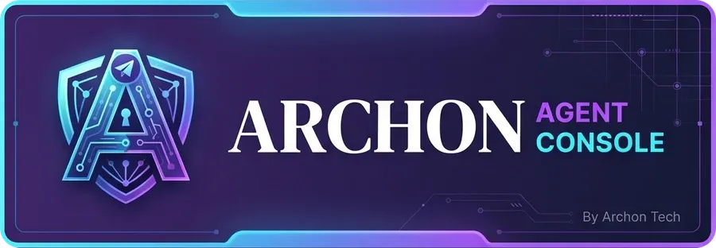
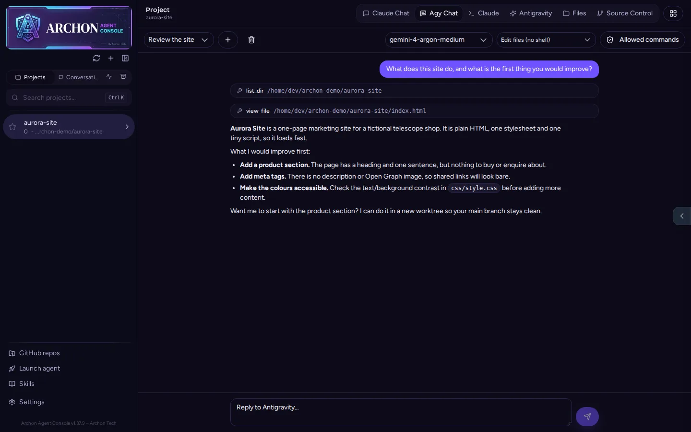
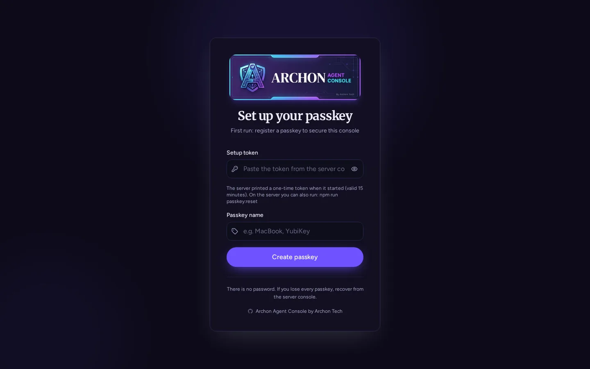
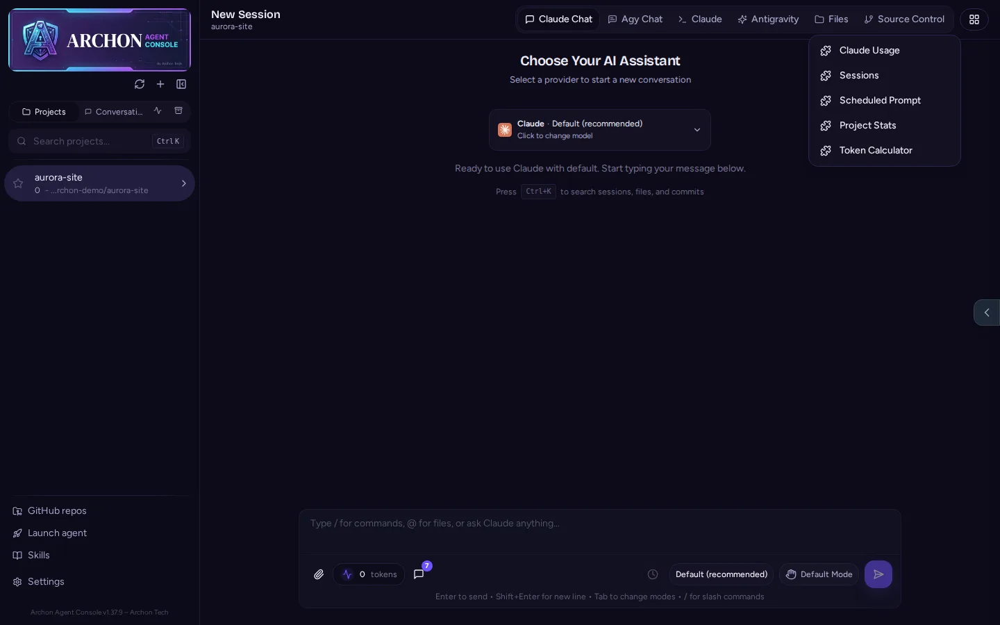
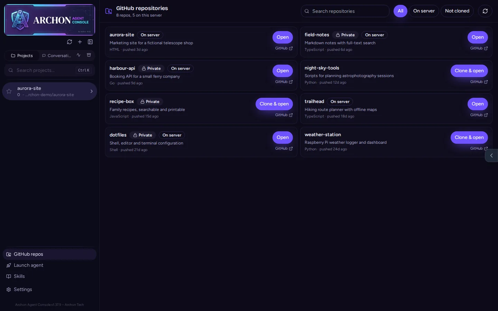
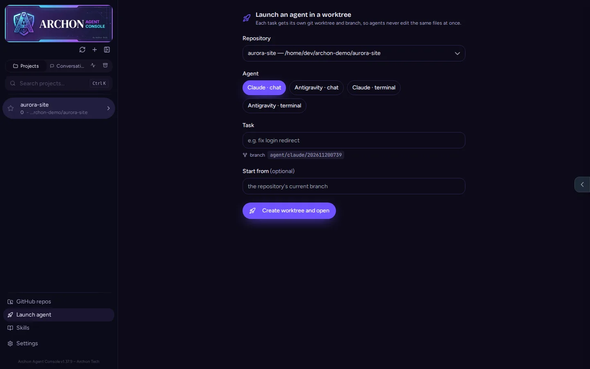
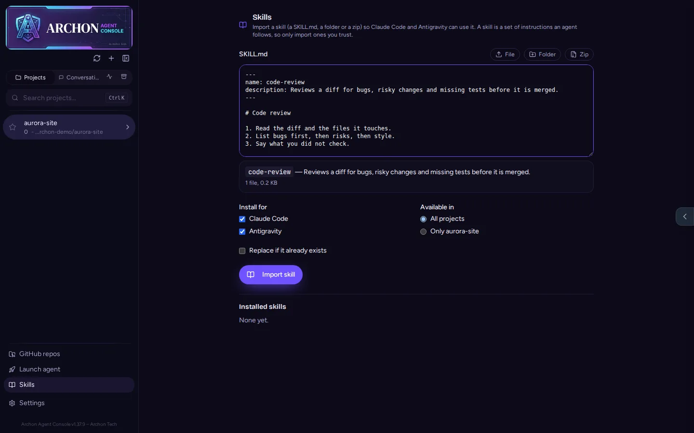
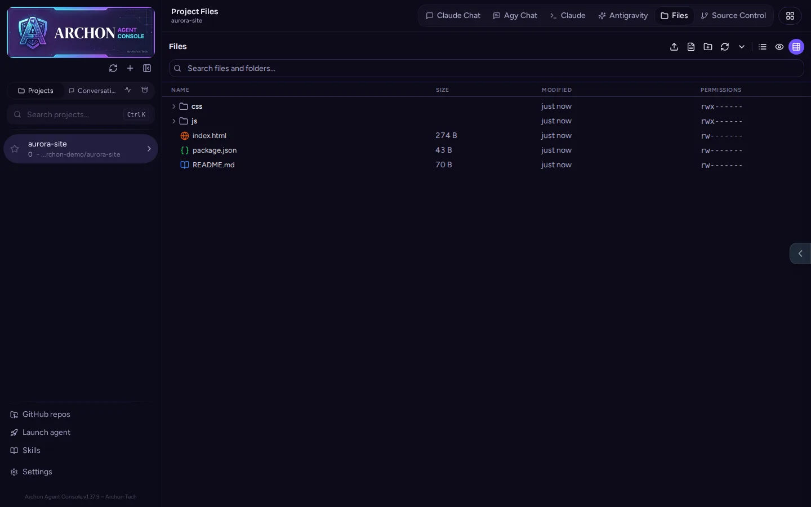

<div align="center">
  
  <p><strong>A private, passkey-secured web console for driving Claude Code and Google Antigravity against your project folders.</strong></p>
  <p>
    
    
    
    
  </p>
  <p>
    <a href="#what-it-does">What it does</a> ·
    <a href="#quick-start">Quick start</a> ·
    <a href="#configuration">Configuration</a> ·
    <a href="#going-live-with-cloudflare">Cloudflare</a> ·
    <a href="#security-model">Security</a> ·
    <a href="#credits-and-licence">Licence</a>
  </p>
</div>



## What it does

Archon Agent Console is one browser tab for the AI coding agents you run on a dev server. Open a project, chat with **Claude Code** or **Antigravity (`agy`)**, watch them read and edit files, browse the repo, and launch each task in its own git worktree. It is built to sit behind a Cloudflare tunnel and be safe to leave on the internet: nothing is reachable without a passkey, and the agents run as the service user, not as root.

Made by [Josh Neufield](https://archontech.au) at Archon Tech.

### Sign-in and access

- **Passkeys only.** No passwords and no email or SMS recovery. Register several passkeys and revoke any of them from *Settings → Security*.
- **First-run setup token.** The server prints a one-time token (valid 15 minutes) on first start. Paste it in the browser and tap your authenticator.
- **Server-side sessions.** A `__Host-` cookie (`HttpOnly; Secure; SameSite=Strict`), 30 minutes idle and 12 hours absolute by default. Ending a session also closes its open terminals and sockets.
- **Cloudflare Access on top.** When enabled, the app verifies the Access JWT itself (signature, issuer, audience, expiry) before serving anything.



### Agents

| Tab | What it is |
| --- | --- |
| **Claude Chat** *(default)* | Claude Code chat with history, tool approvals and file references. |
| **Agy Chat** | A structured Antigravity chat: streamed replies, live progress, tool steps, saved history per project, model picker, Stop button. |
| **Claude** | The Claude Code terminal in the project folder. |
| **Antigravity** | The agy terminal (its own login flow works in the terminal). |
| **Local LLM** *(optional)* | A small model on your own hardware via Ollama: draft-only chat and four task shortcuts. See below. |

Tasks and the plugin tools (Claude Usage, Sessions, Scheduled Prompt and so on) live in the **More** menu at the end of the tab bar, so the sidebar stays free for your projects.



**Agy Chat has three permission modes**, chosen per message:

| Mode | What agy can do |
| --- | --- |
| **Plan only** | Researches and writes a plan. Changes nothing in the project. |
| **Edit files (no shell)** *(default)* | Reads and edits files with its built-in tools. Shell commands are refused. |
| **Full access** | Edits files and runs any command as the server user. Must be picked on purpose and can be switched off with `AGY_CHAT_FULL_ACCESS=false`. |

This matters: `agy -p` with no `--mode` runs commands and writes files anywhere without asking, so the console always passes an explicit mode. In the default mode agy is told up front to use its file tools, which is enough to explore and answer questions about a project. *Allowed commands* lets you permit specific exact command lines (agy matches the whole line, no wildcards) by editing `permissions.allow` in agy's `settings.json` for you.

### Projects, repos and worktrees

- **GitHub repos.** Lists your GitHub repositories (through the server's own `gh` login, so no token ever reaches the browser), shows which are on the server, and opens or clones them as projects. Only repositories in your own account can be cloned.
- **Launch agent in a worktree.** Pick a repo, an agent and a task name. The console creates a git worktree on `agent/<agent>/<task>` and opens it in Claude chat, Claude terminal, Antigravity chat or Antigravity terminal, so two agents never edit the same files.
- **Files and Source Control.** Explorer with editor, upload, rename and delete, plus staging, commits and worktree management. Credential folders (`~/.ssh`, `~/.config`, `~/.claude` and friends) are never listed or readable, even when your home directory is a project root.
- **Browser preview.** The Browser tab can open a site or a running dev server from the server's own browser and shows detected local servers to pick from.




### Skills

*Skills* imports a `SKILL.md` (paste, file, folder or zip) for Claude Code, Antigravity, or both, for all projects or one. It validates the frontmatter, refuses symlinks and path tricks, never overwrites unless you ask, and shows what a skill contains first. Skills that grant tools or run commands need an explicit acknowledgement, because a skill is a set of instructions an agent will follow.



### Phone notifications (Android Chrome)

The console sends Web Push notifications, so your phone tells you when an agent finishes, needs a tool approved, or fails, even with the tab closed. It needs the https address (the Cloudflare hostname).

1. On Android, open the console in Chrome and sign in with your passkey.
2. Chrome menu → **Install app** (or *Add to Home screen*). Installed, it behaves like a native app and notifications are most reliable.
3. Open the installed app → **Settings → Notifications → Notify this browser** and tap *Allow* when Android asks.
4. Pick which events you want: *action required*, *run stopped*, *errors*.

Claude, Codex and OpenCode runs notify as before. **Agy Chat** notifies when a reply takes longer than 20 seconds (so quick answers stay quiet), or fails, and tapping the notification opens the Agy Chat tab. Stopping a turn yourself never notifies. The status-bar icon is a white version of the Archon mark (`public/badge-96.png`), as Android requires.

### Local LLM (optional)

A **Local LLM** tab sits next to the two chats when `OLLAMA_BASE_URL` is set. It talks to an [Ollama](https://ollama.com) server on your LAN, for example a gaming PC with a spare GPU, and is meant as a cheap drafting helper rather than an agent. The default model is `qwen3:8b`.

- **No tools, draft only.** The model gets no filesystem or shell access. Everything it writes is shown as a *Draft* with a Copy button; nothing is saved, run or committed from this tab.
- **Task shortcuts** (buttons, or type the slash command): `/summarise-logs` (paste logs after it), `/explain-diff`, `/commit-msg` (from the staged diff), `/boilerplate` (describe the file you want).
- **Status at a glance.** A green or red dot on the tab and in the header, checked every 30 seconds. When the host is down you get *Local LLM offline* straight away instead of a hang, and an offer to use Claude Chat instead. Nothing switches on its own.
- **Cold starts are expected.** The first reply after the model was unloaded waits up to `OLLAMA_TIMEOUT_MS` (default 120 s) while it loads into VRAM and shows a loading state; opening the tab warms the model up. Once tokens flow, a stalled reply is cut off after `OLLAMA_IDLE_TIMEOUT_MS` (30 s).
- **Small context, on purpose.** Requests use an 8192-token window (`OLLAMA_NUM_CTX`, never above 16384) and the model is unloaded from VRAM five minutes after the last use, so the GPU is free for games. A diff or log that does not fit is **refused with its size** rather than silently cut.
- **What never leaves this machine.** Before anything is sent, text is checked for secrets (private keys, API and cloud tokens, bearer tokens, passwords in URLs, `NAME=value` secrets) and refused if found. Diffs also drop lockfiles, `.env` files, key files and binaries, and say what was left out. Only the selected project's own `git diff` is read.
- **Thinking** is off by default (faster). Switch it on for *Explain diff* when you want the model to reason first.

```bash
# in ~/.config/archon-agent-console/env (not in the repository)
OLLAMA_BASE_URL=http://<ollama-host>:11434
```

The address must be on this machine or a private network; public hosts are refused. Ollama itself has no login, so keep it LAN-only: do not publish it through a tunnel or port forward.

### Prod Claude (optional)

If a second machine (for example your production Docker host) runs its own Claude Code, the **Prod Claude** tab opens a terminal to it from the console. It is deliberately kept apart from this server's agents:

- It is an ssh session to the other machine, so it has its own files, history and permissions. This server's Google Drive, repos and agents are not visible to it, and it cannot see them.
- The session starts from an **empty environment**: none of this server's tokens or API keys are passed on. No ssh agent, no forwarding, no config files, and the host's SSH key is pinned.
- It has its own terminal slot and a red "PRODUCTION" banner, so it cannot be mistaken for the local Claude tab.
- Agents on this server cannot type into it. The terminal is only reachable through your signed-in browser session.

Set it up once:

```bash
scripts/setup-prod-claude.sh <ssh-user> <host> /full/path/to/claude
```

It creates a key used only for this tab, pins the host's SSH key (compare the printed fingerprint with `ssh-keygen -lf /etc/ssh/ssh_host_ed25519_key.pub` on that host), and prints one line for the other host's `~/.ssh/authorized_keys`. That line starts with `restrict,pty,command="..."`, so the key can only launch Claude Code there, never a shell, a file copy or a port forward. The tab appears once the config exists.

The key file lives on this server as the service user, so a compromised agent here could still read it. The red banner and the restricted key limit what it could do with it; treat the production Claude's own permission prompts as the last line of defence.

### Creative tools (optional)

`scripts/install-craft-mcp.sh` adds [ArtCraft's Crafting Apps](https://getartcraft.com/apps) as MCP servers for Claude Code, so Claude can edit **PSD, DOCX, XLSX, PDF, SVG, video and CAD files** on the server: PhotoCraft (Photoshop-style), WordCraft, DeckCraft, GridCraft, VectorCraft, PdfCraft, LightCraft, FilmCraft, DesignCraft, EffectCraft, CADCraft and SoundCraft. They are the vendor's own signed headless CLIs, not a third-party gateway. For each app the script verifies the signing key's pinned fingerprint, the SHA-256, both PGP signatures and the archive paths, then does a real MCP handshake before registering it (`claude mcp add --scope user`). Everything installs under `~/.local/opt/artcraft`, with no root.

```bash
scripts/install-craft-mcp.sh            # install the default set
scripts/install-craft-mcp.sh photo pdf  # or just some
scripts/install-craft-mcp.sh --list     # what is installed and registered
scripts/install-craft-mcp.sh --remove word
```

An MCP server runs as the service user, and Claude asks before using each tool unless you allow it.

### Look and feel

Archon Tech branding throughout: dark theme with the Archon palette, banner and app icon, installable as a PWA.



## Quick start

Requires **Node 22 or newer** (developed on 26) and the CLIs you want to drive (`claude`, `agy`, and `gh` for the GitHub view).

```bash
git clone https://github.com/NinjaInc/archon-agent-console && cd archon-agent-console
npm ci && npm run build
cp .env.example .env        # set APP_ORIGIN, RP_ID, PROJECTS_ROOTS
npm run server              # http://127.0.0.1:3001
```

On first start the console prints a **one-time setup token**. Open `APP_ORIGIN`, paste the token, name your passkey and tap your authenticator. Add more passkeys later in *Settings → Security*.

> **Testing locally?** Use `APP_ORIGIN=http://localhost:3001 RP_ID=localhost`. Passkeys need https or `localhost`, so a plain-http LAN address cannot sign in.

> npm 12 skips install scripts by default. `package.json` allow-lists only the native modules the server needs (`bcrypt`, `better-sqlite3`, `node-pty`, `esbuild`, `sharp`).

### Run it as a service

Run it as a systemd service so it survives reboots. A user service works well on a single-user box:

```ini
# ~/.config/systemd/user/archon-agent-console.service
[Service]
WorkingDirectory=%h/src/archon-agent-console
EnvironmentFile=%h/.config/archon-agent-console/env
# claude, agy and gh must be on PATH (a service starts with a minimal one)
Environment=PATH=%h/.local/bin:/usr/local/bin:/usr/bin:/bin
ExecStart=/usr/bin/node dist-server/server/index.js
Restart=on-failure
UMask=0077
NoNewPrivileges=true
```

Enable lingering (`loginctl enable-linger $USER`) to start it at boot. For a dedicated, sandboxed `archon` user with logrotate, review and run `sudo deploy/install.sh`; `deploy/systemd/` has hardened unit examples. Read the first-run token from the service log, which is kept owner-only.

## Configuration

| Variable | Purpose |
| --- | --- |
| `HOST`, `SERVER_PORT` | Bind address and port. Loopback only by default; anything else makes the server exit. |
| `ALLOW_LAN_BIND` | `true` lets `HOST` be one private LAN IPv4 of this machine (for example when `cloudflared` runs on another host). `0.0.0.0`, `::`, hostnames and public addresses are always refused. |
| `APP_ORIGIN`, `RP_ID`, `RP_NAME` | The exact https origin and WebAuthn relying-party id (usually the hostname). |
| `SESSION_IDLE_MINUTES`, `SESSION_MAX_HOURS` | Idle (30) and absolute (12 h) session limits. |
| `BOOTSTRAP_TOKEN` | Optional fixed first-run token (24+ characters). Otherwise a random readable one is printed. |
| `TRUST_PROXY` | Which proxy hops to trust for client IPs (default `loopback`). Set it when `cloudflared` connects from another host so the rate limiter sees real clients. |
| `CF_ACCESS_REQUIRED`, `CF_ACCESS_TEAM_DOMAIN`, `CF_ACCESS_AUD` | Enforce Cloudflare Access JWT verification. The server refuses to start if required but unconfigured. |
| `PROJECTS_ROOTS` | Comma-separated folders the explorer, terminals and new projects may use (symlinks resolved). Default: `~/projects,~/src,~/drive` that exist. |
| `PROJECTS_DENY` | Replaces the built-in list of credential folders that stay off-limits even inside a root. |
| `GITHUB_CLONE_ROOT` | Where *GitHub repos* clones to, as `<root>/<owner>/<name>` (default `~/projects`). |
| `AGY_NOTIFY_MIN_SECONDS` | Agy Chat only sends a push notification for replies at least this long (default 20). Errors always notify. |
| `VAPID_SUBJECT` | Who push services see as the sender. Defaults to `APP_ORIGIN` (https). |
| `OLLAMA_BASE_URL` | Turns the **Local LLM** tab on. Address of an Ollama server on this machine or a private network, e.g. `http://<ollama-host>:11434`. Public hosts are refused. |
| `OLLAMA_MODEL` | Default local model (default `qwen3:8b`). The picker lists whatever Ollama has installed. |
| `OLLAMA_TIMEOUT_MS` | How long to wait for the first token, covering a cold model load (default `120000`). |
| `OLLAMA_IDLE_TIMEOUT_MS` | How long a reply may go silent once tokens are flowing (default `30000`). |
| `OLLAMA_NUM_CTX` | Context window per request (default `8192`, capped at `16384`; the UI never offers 32k). |
| `OLLAMA_KEEP_ALIVE` | How long Ollama keeps the model in VRAM after the last use (default `5m`). |
| `OLLAMA_API` | `native` (default, `/api/chat`, pins the context size) or `openai` (`/v1/chat/completions` SSE; Ollama ignores `num_ctx` there, so set it in the model's Modelfile). |
| `AGY_CHAT_FULL_ACCESS` | `false` removes the Full access mode from Agy Chat. |
| `DATABASE_PATH` | SQLite file holding passkeys, sessions, chats and app data (default `~/.cloudcli/auth.db`). |

## Going live with Cloudflare

1. **Tunnel.** Install `cloudflared` yourself (this repo never installs system packages), then `cloudflared tunnel login && cloudflared tunnel create archon-console && cloudflared tunnel route dns archon-console <HOSTNAME>`.
2. **Route.** Copy `deploy/cloudflared/archon.yml.example` to `/etc/cloudflared/archon.yml` and point the ingress at `http://127.0.0.1:3001` (the credentials file stays `0600`). Install `deploy/systemd/cloudflared-archon.service`. Websockets work unchanged.
3. **Access.** In *Zero Trust → Access → Applications* add a self-hosted app for `<HOSTNAME>` with an *Allow* policy for your email and an 8 h session. Or read and run `deploy/cloudflare/access.sh.example` / `access.tf.example`.
4. **Enforce it.** Put the app's AUD tag and your team domain in the env file and set `CF_ACCESS_REQUIRED=true`.

Two independent doors: Cloudflare Access decides who may reach the origin, and the passkey decides who may use the console. Both must pass.

## Recovery

Lost every passkey? There is deliberately no remote or email path. On the server:

```bash
npm run passkey:reset   # wipes all passkeys and sessions, prints a new 15-minute setup token
```

## Security model

The console is built around one owner and one trusted machine.

- **No session, no access.** Every API route, terminal and websocket needs a valid passkey session. Cross-origin requests and websockets are rejected, CORS is closed to other origins, and auth endpoints are rate-limited.
- **Loopback by default.** A LAN address is an explicit opt-in for one private IP.
- **Confined files.** Paths are resolved with `realpath` before any check, against `PROJECTS_ROOTS`, with a deny-list for credential folders. Skill imports refuse symlinked targets.
- **Agents are not a sandbox.** Claude Code and agy run as the service user and can do anything that user can. Isolation is the OS account, the permission modes above, and (with `deploy/install.sh`) systemd sandboxing, not a container. Agy Chat defaults to a mode that cannot run commands, but its terminal and the Claude tabs are as capable as a shell.
- **Trust what you open.** Claude Code loads a project's own settings (hooks, MCP servers, skills) when you chat in it. Only open and clone repositories you trust, and review imported skills.
- **Secrets stay server-side.** The `gh` login, agy API key and Cloudflare values never reach the browser. One-time setup tokens are printed only to the owner-only server log.

Known limits: a symlink swapped between the path check and the write (TOCTOU) is not defended against, only a local attacker could win it; and a plain-http LAN address can load the page but cannot sign in.

## Development

```bash
npm run typecheck && npm run lint
npm test               # server (node:test)
npm run test:client    # client (vitest)
npm run test:scripts   # helper scripts (node:test)
npm run dev            # Vite + server with hot reload
```

Server code lives in `server/modules/<feature>/` (service, routes, module wiring, tests) and the client in `src/modules/<feature>/`; both have module standards under `.agents/skills/`.

### Rebasing on upstream

```bash
git remote -v                      # origin = this fork, upstream = siteboon/claudecodeui
git fetch upstream && git rebase upstream/main
npm ci && npm run build && npm test && npm run test:client
```

Expect conflicts in `server/modules/auth/*`, `server/index.ts`, `src/modules/auth/*`, `src/shared/api.ts`, `src/modules/sidebar/*` and `src/index.css` (theme tokens). Regenerate `package-lock.json` if upstream's contains non-npmjs `resolved` URLs.

## Credits and licence

Archon Agent Console is a fork of **[CloudCLI UI](https://github.com/siteboon/claudecodeui)** by siteboon, which provides the chat, terminal, file and git foundations. This fork replaces its login and network model, adds Antigravity, GitHub, worktree and skills features, and re-brands the interface. Thanks to the upstream authors.

Licensed under the **GNU Affero General Public License v3.0 or later**. See [LICENSE](LICENSE). If you modify this software and run it as a network service, you must make your modified source available to its users.

Built on [Claude Code](https://docs.anthropic.com/en/docs/claude-code), [Antigravity](https://antigravity.google), [React](https://react.dev), [Vite](https://vitejs.dev), [Tailwind CSS](https://tailwindcss.com), [CodeMirror](https://codemirror.net), [SimpleWebAuthn](https://simplewebauthn.dev) and [node-pty](https://github.com/microsoft/node-pty).
